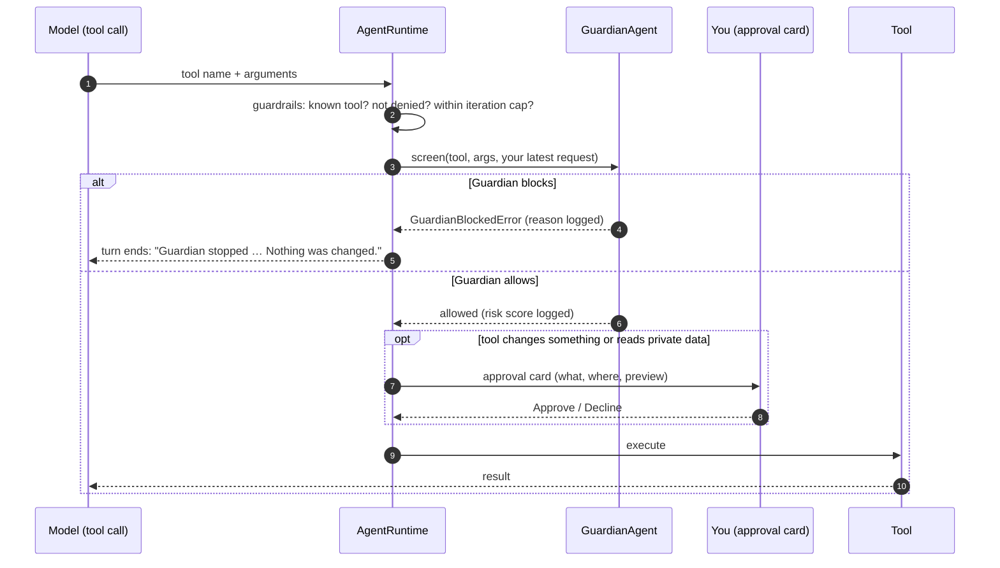
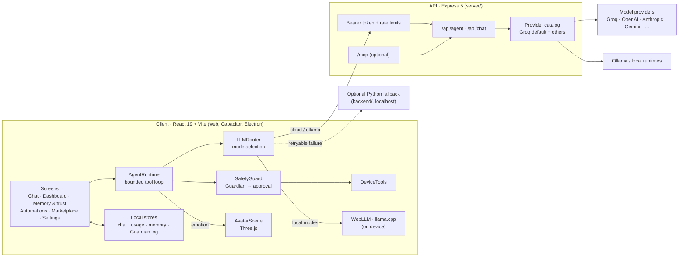

# HANNAH — Your AI Companion

<p align="center">
  <strong>A private, emotion-aware AI companion with a living 3D avatar. No paid tiers. Bring your own key. Every action reviewed.</strong>
</p>

<p align="center">
  <a href="https://github.com/HarshTambade/Shanaya-Your-AI-companion/actions/workflows/build.yml"></a>
  <a href="https://github.com/HarshTambade/Shanaya-Your-AI-companion/releases/latest"></a>
  <a href="https://github.com/HarshTambade/Shanaya-Your-AI-companion/issues"></a>
  <a href="./LICENSE"></a>
</p>

HANNAH (formerly **Shanaya**) is a source-available AI companion for the web, Android, iOS, macOS, Windows and Linux. You talk to her in a chat beside a real-time 3D avatar that reacts to the emotion of each reply. She can remember what you ask her to remember, use a small set of device tools, and run on a cloud model, a local server, or entirely on your device.

Three rules shape the product:

1. **No monetization.** There are no subscriptions, premium tiers, paywalls or ads in the app.
2. **Bring your own key (BYOK).** Paste your own free Groq key and start talking: no account, no sign-up. An operator access token is optional. Keys are kept for the browser tab session only.
3. **Nothing runs unchecked.** Every tool call is reviewed by the **GuardianAgent** first, and anything that changes your device or data also waits for **your approval**.

> **Status:** active development. The latest published release is [v1.0.2](https://github.com/HarshTambade/Shanaya-Your-AI-companion/releases/tag/v1.0.2) (still branded Shanaya). `main` contains the HANNAH v2 redesign, which has not been released yet. See [Project status](#project-status) for what is finished and what is experimental.

---

## Contents

- [Downloads](#downloads)
- [What you can do](#what-you-can-do)
- [The safety model: Guardian, then you](#the-safety-model-guardian-then-you)
- [Architecture](#architecture)
- [Privacy and data](#privacy-and-data)
- [Quick start](#quick-start)
- [Configuration](#configuration)
- [Inference modes](#inference-modes)
- [Model routing](#model-routing)
- [Agent runtime and tools](#agent-runtime-and-tools)
- [Agent team](#agent-team)
- [Accounts and your own database](#accounts-and-your-own-database)
- [Marketplace: agents and skills](#marketplace-agents-and-skills)
- [Automations](#automations)
- [MCP integration](#mcp-integration)
- [Desktop computer use](#desktop-computer-use)
- [Voice and calls](#voice-and-calls)
- [Mobile, desktop and PWA builds](#mobile-desktop-and-pwa-builds)
- [Deployment](#deployment)
- [API reference](#api-reference)
- [Project structure](#project-structure)
- [Development commands](#development-commands)
- [Testing](#testing)
- [Project status](#project-status)
- [Troubleshooting and FAQ](#troubleshooting-and-faq)
- [Contributing](#contributing)
- [Further documentation](#further-documentation)
- [License](#license)

---

## Downloads

Installers for **HANNAH 1.3.0** are attached to the [latest release](https://github.com/HarshTambade/Shanaya-Your-AI-companion/releases/latest), with a `SHA256SUMS` file to check them. The links below always point at the newest release.

| Platform | Download | Before you install |
| --- | --- | --- |
| macOS | [Apple silicon](https://github.com/HarshTambade/Shanaya-Your-AI-companion/releases/latest/download/HANNAH-macOS-AppleSilicon.dmg) · [Intel](https://github.com/HarshTambade/Shanaya-Your-AI-companion/releases/latest/download/HANNAH-macOS-Intel.dmg) | Not notarized yet. The first time, Control-click HANNAH in Applications and choose **Open**. |
| Windows | [Installer](https://github.com/HarshTambade/Shanaya-Your-AI-companion/releases/latest/download/HANNAH-Windows.exe) | Not code-signed yet, so SmartScreen may warn: choose **More info → Run anyway**. Uninstall from Settings → Apps. |
| Linux | [AppImage](https://github.com/HarshTambade/Shanaya-Your-AI-companion/releases/latest/download/HANNAH-Linux.AppImage) · [.deb](https://github.com/HarshTambade/Shanaya-Your-AI-companion/releases/latest/download/HANNAH-Linux.deb) | x86-64. `chmod +x` the AppImage and run it, or install the `.deb`. |
| Android | [APK](https://github.com/HarshTambade/Shanaya-Your-AI-companion/releases/latest/download/HANNAH-Android.apk) | A debug-signed test build for sideloading until a Play signing key is configured. |
| iOS | Not distributed yet | iOS apps need an Apple Developer signing identity. Build from source with Xcode ([Mobile, desktop and PWA builds](#mobile-desktop-and-pwa-builds)) or use the web app in Safari. |
| Web / PWA | Deploy it yourself; see [Deployment](#deployment). | Installable from a supported browser. |

What changed in each version is in [CHANGELOG.md](./docs/CHANGELOG.md). [Platform support](./docs/PLATFORM_SUPPORT.md) lists what works on each operating system and what was verified. Builds on `main` upload temporary [Actions artifacts](https://github.com/HarshTambade/Shanaya-Your-AI-companion/actions/workflows/build.yml) without creating a release.

---

## What you can do

Every screen has its own address, so refresh, bookmarks and the back button work, and older `#/chat`-style links redirect. The build writes an `index.html` for each route, so any static host serves them without rewrite rules. Every screen except the landing page, Marketplace and Integrations needs a connection first; opening one signed out asks you to connect, then takes you there. Unknown addresses show a "Page not found" screen.

| Screen | Route | What it does |
| --- | --- | --- |
| **Landing** | `/` | Introduces HANNAH. **Talk to HANNAH** opens the connect dialog: paste your Groq key (checked with Groq before the app opens). **I have an access token** is optional, for operator-provided models and features. When the server has a database, **Sign in or create one** opens email and password sign-in. |
| **Chat** | `/chat` | Conversation beside the 3D avatar. Pick a model, or **Auto** to let HANNAH choose a provider and model for each message in your [routing mode](#model-routing). A line above the message box previews the choice before you send. Speak or type, rate replies, approve or decline actions on the in-chat approval cards, and press **Stop** to halt a running task before its next step. Turn on **Team** to have HANNAH plan the task with specialist agents and verify the result. |
| **Dashboard** | `/dashboard` | Bento-style overview built only from data on this device: replies this week, success rate, a 30-day activity matrix, your reply feedback, where you left off, memory and Guardian counts, and per-model latency and tokens. **Across your devices** shows agent team tasks and automations from all your signed-in devices and lets you approve or deny their next step here (see [Tasks across devices](#tasks-across-devices)). Also holds **Reminders**: add, cancel, and allow notifications. Empty states show `—` or `0`, never sample numbers. |
| **Agents** | `/agents` | The agent team: Research, Coding, Memory and Tasks specialists with their tools and model choice (Auto or a specific model), the always-on verification agent, and **Team activity**: every team run's plan, which steps ran in parallel, each step's status and result, verification and the final answer. Interrupted or stopped runs can be resumed, on this device or, when you're signed in, on any of your devices; runs another device is working on show its name and a **Cancel** button. |
| **Models** | `/models` | Model advisor. Enter or detect your device (RAM, GPU, VRAM, Apple unified memory) and pick a task, budget and goal (cheapest, fastest, best coding, privacy-first and so on). HANNAH ranks hosted and local models, shows whether each fits your memory (weights + KV cache + runtime), cost, privacy and limitations, and sets your choice for chat. |
| **Memory & trust** | `/memory` | The accountability page: an **Agent runs** log (every request with each tool step and how it ended, which survives reloads), Guardian strictness and its decision log (allowed and blocked, with reasons), saved memories you can edit or delete, personalization examples, the active persona, and installed plugins. |
| **Automations** | `/automations` | Routines built from trigger, agent-task, action and output steps that run on a schedule while HANNAH is open, with approval before every action and a run history. See [Automations](#automations). |
| **Marketplace** | `/marketplace` | First-party agents and skills that change how HANNAH replies, plus **Community skills**: paste or open a skill manifest, review its publisher, permissions, privacy and integrity, then install and turn it on. |
| **Integrations** | `/integrations` | REST and MCP guide with copyable examples, tool limits, server environment and host setup. **Database**: connection status and a guided setup for Supabase, Neon, any Postgres or SQLite, with a connection test for the operator. **Tools from other MCP servers**: what HANNAH can use as an MCP client. |
| **Settings** | `/settings` | Connection (token, Groq key, disconnect). **Account** (when the server has a database): sign in, saved provider keys, sync, developer API keys, webhooks, security activity, export and deletion. **Calendar and email**: connect Google or Microsoft with their own sign-in. **Voice**: speaking and listening engines, voice choice, interrupt-by-talking and the **“Hey HANNAH”** wake word. Your data: per-item counts with **Clear** for conversation, memories and style feedback, **Export my data** as JSON, and **Delete everything**. Developer options. |

The design follows a bento and glassmorphism style: rounded `2rem` cards, pastel tones (sky, lavender, butter, mint), large light-weight stat numbers and a floating header. Layouts are responsive down to phone width.

---

## The safety model: Guardian, then you

Every action passes through the same chain, whether a model asked for it, it was a desktop action, or it changes memory:



### GuardianAgent

[`GuardianAgent.ts`](./client/src/services/GuardianAgent.ts) scores each proposed action, checks it against known attack patterns (for example `rm -rf` or "ignore previous instructions"), and looks for multi-step attempts across your last 10 actions. Its decisions are stored on the device (latest 100) and shown on **Memory & trust**.

| Strictness | Blocks |
| --- | --- |
| Permissive | Known attack patterns only. Approval is still required for every change. |
| Balanced (default) | Also blocks multi-step attempts to get around safety rules. |
| Strict | Also blocks high-risk actions, such as deleting or overwriting files, before they reach you. |

### Human-in-the-loop approval

[`SafetyGuard.ts`](./client/src/services/SafetyGuard.ts) and [`ApprovalCenter.ts`](./client/src/services/ApprovalCenter.ts) handle confirmation:

- With the chat open, an amber **approval card** appears in the conversation. It names the action, shows the target and a preview (a file write shows the path, byte size and first 700 characters), and offers **Approve** and **Decline**.
- With no chat open, HANNAH falls back to the native dialog on mobile or the browser's confirm dialog. If the chat closes while a request is pending, the request is declined.
- Declining ends the task with "Action cancelled. HANNAH did not make any changes."
- Approved actions are recorded in the local side-effect ledger.

### Other guardrails

- **Agent guardrails** ([`AgentGuardrails.ts`](./client/src/services/AgentGuardrails.ts)) flag prompt-injection phrases, deny shell and terminal tools, apply optional output deny-lists, and redact common credential, email, phone, ID and payment-card patterns from generated and tool text.
- **Iteration caps:** 8 tool rounds by default (`VITE_AGENT_MAX_ITERATIONS`), never more than 20.
- **Circuit breaker:** a tool that fails 3 times in a row is disabled for the session.
- **Routing profiles** limit which tools a task type can see (see [Agent runtime and tools](#agent-runtime-and-tools)).
- **Server limits:** with only a Groq key, a visitor can reach just the chat routes, and their key is forwarded only to Groq's official API. Server-held keys and every other route need the operator token. Rate limits apply per token and per visitor key.

These checks are defense in depth. They are not a guarantee against every prompt injection, so test your own release build before relying on them.

---

## Architecture



### Request flow

1. You send a message from **Chat**.
2. `AgentRouter` classifies the request (chat, code, system, research and so on) and picks a profile with its allowed tools and iteration limit.
3. `LLMRouter` resolves the inference mode. Local modes generate on the device; cloud and Ollama modes call `POST /api/agent` with your token, plus your Groq key in the `X-Groq-API-Key` header if you gave one.
4. The server validates and bounds the request, adds your saved memories to the system prompt, calls the selected provider, and returns the reply, emotion, model, provider, latency and token usage.
5. A tool call goes through the [safety chain](#the-safety-model-guardian-then-you), then the result is sent back for the next step.
6. The final reply is rendered as Markdown, spoken if voice is on, and its emotion (`happy`, `sad`, `angry`, `neutral`, `surprised` or `thinking`) drives the avatar's face, pose and gestures. Turn metrics are saved for the Dashboard.

### Main modules

| Area | Files | Responsibility |
| --- | --- | --- |
| Composition and routing | [`App.tsx`](./client/src/App.tsx), [`AppShell.tsx`](./client/src/components/AppShell.tsx) | Hash routes, the connection gate and the floating header. |
| Chat | [`ChatUI.tsx`](./client/src/components/ChatUI.tsx), [`MessageContent.tsx`](./client/src/components/MessageContent.tsx) | Modes, voice, approval cards, ratings, Markdown replies. |
| Agent | [`AgentRuntime.ts`](./client/src/services/AgentRuntime.ts), [`AgentRouter.ts`](./client/src/services/AgentRouter.ts), [`LLMRouter.ts`](./client/src/services/LLMRouter.ts) | Tool loop, task profiles, mode routing. |
| Safety | [`GuardianAgent.ts`](./client/src/services/GuardianAgent.ts), [`SafetyGuard.ts`](./client/src/services/SafetyGuard.ts), [`ApprovalCenter.ts`](./client/src/services/ApprovalCenter.ts), [`AgentGuardrails.ts`](./client/src/services/AgentGuardrails.ts), [`CircuitBreaker.ts`](./client/src/services/CircuitBreaker.ts) | Review, approval, guardrails. |
| Tools | [`DeviceTools.ts`](./client/src/services/DeviceTools.ts), [`DesktopBridge.ts`](./client/src/services/DesktopBridge.ts) | Device and desktop actions. |
| Local data | [`ChatHistory.ts`](./client/src/services/ChatHistory.ts), [`UsageStats.ts`](./client/src/services/UsageStats.ts), [`MemoryStore.ts`](./client/src/services/MemoryStore.ts), [`PersonalizationEngine.ts`](./client/src/services/PersonalizationEngine.ts) | On-device stores behind the Dashboard and Memory & trust. |
| Persona and marketplace | [`PersonaKernel.ts`](./client/src/services/PersonaKernel.ts), [`MarketplaceService.ts`](./client/src/services/MarketplaceService.ts), [`PluginLoader.ts`](./client/src/services/PluginLoader.ts) | Persona prompt, agent and skill catalog, plugin state. |
| Native | [`AIService.ts`](./client/src/services/AIService.ts), [`MobileAgent.ts`](./client/src/services/MobileAgent.ts) | llama.cpp GGUF models and the optional MobileClaw agent. |
| Avatar and voice | [`AvatarScene.tsx`](./client/src/components/AvatarScene.tsx), [`avatar/`](./client/src/services/avatar/), [`SpeechService.ts`](./client/src/services/SpeechService.ts), [`VoiceService.ts`](./client/src/services/VoiceService.ts) | GLB avatar, facial expressions, body poses and gestures, speech in and out. |
| API | [`server/index.js`](./server/index.js), [`server/api-security.js`](./server/api-security.js) | Routes, auth, rate limits, provider calls. |
| Providers | [`server/providers/catalog.js`](./server/providers/catalog.js), [`server/providers/runtime.js`](./server/providers/runtime.js) | Provider presets, model discovery, request adapters. |
| MCP | [`server/mcp-core.mjs`](./server/mcp-core.mjs), [`mcp-http.mjs`](./server/mcp-http.mjs), [`mcp-stdio.mjs`](./server/mcp-stdio.mjs) | Exposes HANNAH to MCP hosts. |

### Vercel topology

The root [`vercel.json`](./vercel.json) defines two services in one project:

```text
/api/*  → server (Express)
/mcp    → server (when MCP_ENABLED=true)
/*      → client (Vite static build)
```

The browser uses same-origin `/api` URLs, so `VITE_API_BASE_URL` stays empty on Vercel.

---

## Privacy and data

| Data | Where it lives | How long |
| --- | --- | --- |
| Access token and your Groq key | `sessionStorage` in this tab (`hannah.session.apiToken`, `hannah.session.groqKey`) | Until you close the tab or press **Disconnect**. Never in `localStorage` or a build variable. |
| Groq key in transit | `X-Groq-API-Key` header → your API → Groq over HTTPS only | Not logged or stored by the server. |
| Server provider keys | Server environment only | Never in `VITE_*` variables or the client bundle. |
| Chat history | `localStorage` (`hannah.chat.history.v1`) | Until you clear it in Settings. |
| Usage metrics | `localStorage` (`hannah.usage.turns.v1`): latency, success, provider, model and token counts. **No message text.** | Last 1,000 turns, or until cleared. |
| Memories | `localStorage` (`hannah.memory.v1`), sent with your requests so HANNAH can use them | Until you edit or delete them on Memory & trust. |
| Guardian log and strictness | `localStorage` (`hannah.guardian.*`) | Last 100 decisions. |
| Reply ratings | `localStorage` (`hannah.personalization.v1`) | Until you clear style data. |
| Conversation content on the server | Passed to the provider for the request and not stored. | Request lifetime. |
| Account data (only if you sign in, and only when the operator connected a database) | The operator's database: your email, a scrypt password hash, session and API-key hashes, provider keys encrypted with envelope encryption, synced memories, reminders, chat history and preferences, webhooks and a security log | Until you delete it, or delete the account in Settings → Account. |
| Account session | An HttpOnly cookie on the web (the app can't read it); a session token in app storage on native apps | 30 days from last use, or until you sign out. |
| Team runs | `localStorage` (`hannah.teamRuns.v1`): plans, step results and final answers | Last 20 runs, or until cleared on the Agents screen. |
| Voice with hosted engines | Reply text goes to OpenAI (OpenAI voices) and recordings to Groq (Whisper) only when you choose those engines | Request lifetime on HANNAH's server; the provider's own policy applies. |

**Telemetry.** The client sends a small allow-list of metadata events (for example `chat_opened` and `tool_confirmation_approved`) to your own server's `/api/events`, which writes them to its log. No message text, prompts or keys are included. **Sentry** and **PostHog** stay off unless you set their keys, and Sentry events are scrubbed of keys, tokens, chat text and file paths.

**Cloud providers** handle prompts under their own retention and training policies. For maximum privacy, use WebLLM, on-device llama.cpp or a local Ollama server.

See [`docs/PRIVACY_POLICY.md`](./docs/PRIVACY_POLICY.md) and [`RESPONSIBLE_AI.md`](./docs/RESPONSIBLE_AI.md).

---

## Quick start

### Requirements

- Node.js 20 or newer (CI uses Node 24) and npm
- Git and a modern browser (WebGPU for WebLLM)
- Optional: Ollama, Python 3.12 (fallback service), Android Studio, Xcode with CocoaPods

### 1. Install

```bash
git clone https://github.com/HarshTambade/Shanaya-Your-AI-companion.git
cd Shanaya-Your-AI-companion
npm install
npm install --prefix client --ignore-scripts
npm install --prefix server
```

The client installs with `--ignore-scripts` because a transitive package ships a broken lifecycle script that the app doesn't need.

### 2. Configure the server

```bash
cp server/.env.example server/.env
openssl rand -hex 32   # paste the output into HANNAH_API_TOKEN
```

Minimal `server/.env`:

```dotenv
PORT=3001
HOST=127.0.0.1
CLIENT_ORIGIN=http://localhost:5173
# Optional: operator access for server-held keys. Visitors can always bring their own Groq key.
HANNAH_API_TOKEN=<32–512 random characters>
GROQ_API_KEY=
GROQ_MODEL=openai/gpt-oss-120b
GROQ_MODEL_FALLBACKS=openai/gpt-oss-20b,llama-3.1-8b-instant
```

The legacy name `SHANAYA_API_TOKEN` is still accepted.

### 3. Configure the client (optional)

```bash
cp client/.env.example client/.env
```

The Vite dev server proxies `/api` to `localhost:3001`, so no settings are required for local development.

### 4. Run

```bash
npm run dev             # server on :3001 and client on :5173
curl http://localhost:3001/api/health
```

Open `http://localhost:5173`, choose **Talk to HANNAH**, and paste your own [Groq key](https://console.groq.com/keys). To use the server's own keys instead, open **I have an access token** and enter the token from step 2.

### Optional: Python model-step fallback

If Express fails with a network error, timeout, rate limit or 5xx, the client can ask the FastAPI service in [`backend/`](./backend) for one model step. The client still owns tool validation and approvals.

```bash
python3 -m venv .venv && source .venv/bin/activate
python -m pip install -r backend/requirements.txt
cp .env.example .env            # set the fallback provider key
npm run dev:with-python-fallback
```

The Python service binds to localhost only, requires approval for every tool (including reads) over a session-bound WebSocket, runs code in a network-disabled Docker container, and writes a redacted, hash-chained audit log to `logs/hannah_audit.jsonl`.

---

## Configuration

### Client: `client/.env`

| Variable | Purpose |
| --- | --- |
| `VITE_API_BASE_URL` | API origin when it differs from the page origin (for example on a phone). Leave empty for the Vite proxy or Vercel. |
| `VITE_SITE_URL` | Public HTTPS origin for canonical URLs, social cards, `robots.txt` and `sitemap.xml`. |
| `VITE_PYTHON_FALLBACK_URL` | Optional FastAPI fallback (default `http://127.0.0.1:8000`). |
| `VITE_AGENT_MAX_ITERATIONS` | Tool rounds per request (default 8, maximum 20). |
| `VITE_AGENT_TOOL_DENY_LIST` | Extra tool names to deny, added to the built-in shell and terminal deny list. |
| `VITE_AGENT_OUTPUT_DENY_SUBSTRINGS` | Comma-separated phrases blocked in assistant output. |
| `VITE_OFFLINE_MODEL_URL` | HTTPS URL of a GGUF model for on-device AI on iOS and Android. |
| `VITE_AVATAR_MODEL_URL` | Avatar asset. When blank, the app loads the uncompressed 7.4 MB `uruha_rushia_-_hololive_vtuber.glb`; set `/models/avatar.draco.glb` (2.6 MB, what CI's web build uses) after `npm run models:draco`. |
| `VITE_HANNAH_ANTHROPIC_MODEL` | Model for the optional native MobileClaw agent. |
| `VITE_PINECALL_AGENT_ID` | Public Pinecall agent slug for voice calls. |
| `VITE_AGE_GATE_18_PLUS` | `true` shows an 18+ consent gate. |
| `VITE_SENTRY_DSN`, `VITE_SENTRY_*` | Optional browser error tracking; off when blank. |
| `VITE_POSTHOG_KEY`, `VITE_POSTHOG_HOST` | Optional product analytics; off when blank. |
| `VITE_*_DOWNLOAD_URL` | Installer links for a Downloads menu (the component exists but is not shown in the app yet). |

Never put a secret in a `VITE_*` variable: Vite embeds those values in the public bundle.

### Server: `server/.env`

| Variable | Default | Purpose |
| --- | --- | --- |
| `HANNAH_API_TOKEN` | — | Operator bearer token, needed for server-held provider keys and for TTS, calls, desktop control, feedback and sync. When unset, the server serves bring-your-own-key visitors only. A value that is set must be 32–512 characters. |
| `HANNAH_RATE_LIMIT_WINDOW_MS` | `60000` | Rate-limit window. |
| `HANNAH_RATE_LIMIT_{CHAT,AGENT,DESKTOP,FEEDBACK,CONTENT_REPORT}_MAX` | `30`, `60`, `20`, `10`, `10` | Requests per token per window. |
| `PORT`, `HOST` | `3001`, `127.0.0.1` | Bind address. Use `0.0.0.0` only on a trusted LAN. |
| `CLIENT_ORIGIN` | Local origins | Comma-separated CORS allow-list. CORS is not authentication. |
| `HANNAH_DEFAULT_PROVIDER` | `groq` | Default provider in the model picker. |
| `GROQ_API_KEY`, `GROQ_MODEL`, `GROQ_MODEL_FALLBACKS` | —, `openai/gpt-oss-120b`, `openai/gpt-oss-20b,llama-3.1-8b-instant` | Groq configuration. |
| `<PROVIDER>_API_KEY`, `_BASE_URL`, `_MODEL`, `_MODELS` | — | Enables a provider: OpenAI, Anthropic, Gemini, OpenRouter, Together, Cerebras, DeepSeek, Mistral, xAI, Fireworks, NVIDIA, SambaNova, Perplexity or Hyperbolic. |
| `CUSTOM_BASE_URL`, `CUSTOM_API_KEY`, `CUSTOM_MODEL(S)` | — | Any OpenAI-compatible gateway (legacy `CLOUD_API_URL` and `CLOUD_API_KEY` also work). |
| `OLLAMA_BASE_URL`, `OLLAMA_MODEL` | `http://localhost:11434`, `qwen3:8b` | Ollama. |
| `LMSTUDIO_*`, `LLAMACPP_*`, `VLLM_*` | — | Other local OpenAI-compatible runtimes. |
| `CLOUD_REQUEST_TIMEOUT_MS` | `60000` | Per-model timeout (3–120 s). |
| `HANNAH_DAILY_BUDGET_USD` | — | Daily spending cap per token, account or visitor key, estimated from list prices. Users can set a lower cap in Settings. Stored in the database when one is connected, otherwise in memory per server process. |
| `DATABASE_URL` | — | Turns on accounts, sync, the key vault, developer keys, webhooks and persistent budgets. `postgres://…` for Supabase, Neon or any Postgres, or `sqlite:./data/hannah.db` for one self-hosted server. See [Accounts and your own database](#accounts-and-your-own-database). |
| `DATABASE_SSL`, `DATABASE_CA_CERT`, `DATABASE_POOL_MAX` | verified TLS, —, `3` | TLS mode (`no-verify` or `off` only if your provider needs it), a custom CA certificate, and the connection pool size. |
| `HANNAH_VAULT_KEY`, `HANNAH_VAULT_PREVIOUS_KEYS` | — | 32-byte master key (`openssl rand -hex 32`) that encrypts saved provider keys, and older keys still accepted during rotation. |
| `HANNAH_ALLOW_SIGNUP` | `true` | Set `false` to close new sign-ups. |
| `HANNAH_ACCOUNTS_USE_SERVER_KEYS` | `false` | `true` lets signed-in users use the server's provider keys, which you pay for. By default each user brings their own keys. |
| `OPENAI_TTS_MODEL`, `GROQ_STT_MODEL` | `gpt-4o-mini-tts`, `whisper-large-v3-turbo` | Models for the hosted voice engines. |
| `HANNAH_MCP_SERVERS` | — | JSON list of outside MCP servers HANNAH can use as a client, for example `[{"id":"docs","name":"Team docs","url":"https://…/mcp","headers":{"Authorization":"Bearer …"}}]`. |
| `HANNAH_PUBLIC_URL` | request host | Public base URL used in the A2A agent card. |
| `HANNAH_PROVIDER_FALLBACKS` | — | Comma-separated providers to try when `hannah-auto` requests without a routing mode fail with a retryable error, for example `openrouter,together`. Never used for visitor keys or a pinned provider. Routed requests fall back to the router's own alternatives. |
| `HANNAH_SELF_HOSTED_PROVIDERS` | — | Providers to treat as self-hosted in Private mode even on a public address, for example `custom,vllm` for your own inference box. Local runtimes and loopback or private-network endpoints count already. |
| `MCP_ENABLED`, `MCP_API_TOKEN`, `HANNAH_API_URL` | `false`, —, `http://127.0.0.1:3001` | Remote MCP endpoint. |
| `ANTHROPIC_DESKTOP_MODEL` | `claude-sonnet-5-5` | Model for desktop computer use (needs `ANTHROPIC_API_KEY`). |
| `MITHI_TTS_URL` | — | Optional Mithi text-to-speech service. |
| `PINECALL_TOKEN_URL` | — | Trusted issuer of short-lived Pinecall credentials. |
| `SENTRY_*`, `LLM_TRACE_LOG`, `LANGFUSE_*` | — | Optional error tracking and metadata-only LLM traces. |
| `FEEDBACK_DISCORD_WEBHOOK_URL`, `MONGODB_*` | — | Destinations for in-app feedback (`/api/feedback` returns 503 without one). |
| `CONTENT_REPORT_LOG` | `logs/content_reports.jsonl` | Metadata-only AI content reports. |

[`server/.env.example`](./server/.env.example) lists every variable with comments. Real `.env` files are git-ignored.

---

## Inference modes

| Mode | Where it runs | Notes |
| --- | --- | --- |
| **Groq Cloud** (default) | Your API → the selected provider | Any provider configured on the server appears in the picker. The server discovers models and falls back only through your configured list. |
| **WebLLM Local** | In the browser via WebGPU | Downloads Llama 3.2 1B (about 900 MB) on first use, showing progress, and keeps it cached for offline use. Needs WebGPU (recent Chrome or Edge, or Safari 26+). If loading fails, the chat says why and offers **Retry** or **Use cloud instead**. Prompts stay on the device. |
| **Local Ollama** | Your API → your Ollama server | `ollama serve && ollama pull qwen3:8b`. |
| **On-device AI** | iOS and Android via llama.cpp | Needs `VITE_OFFLINE_MODEL_URL`; prepare the model while online. |
| **MobileClaw · Anthropic** | iOS and Android native agent | Uses an Anthropic key stored by the native plugin; optional local LanceDB memory. |
| **Desktop Agent** | Electron with the desktop bridge | Computer use with approval for every action. |

When offline, HANNAH chooses llama.cpp on mobile and WebLLM on web and desktop.

## Model routing

With the chat model set to **Auto**, the [router](./server/router.js) picks a provider and model for each message from every provider you can use: the server's providers for the operator, your saved keys when signed in, or Groq for a visitor key. Choose how in chat settings, under **How Auto chooses**:

| Mode | Picks |
| --- | --- |
| **Balanced** (default) | A model that fits the message: light for everyday chat, stronger for coding, research and reasoning. |
| **Best quality** | The most capable model you can use, every time. |
| **Budget** | The lowest-cost model that can still handle the message. |
| **Fastest** | The lowest measured latency (after three real replies), then models profiled as fast. |
| **Private** | Only self-hosted models: Ollama, LM Studio, llama.cpp, vLLM, or a provider on a loopback or private-network address, or one listed in `HANNAH_SELF_HOSTED_PROVIDERS`. |
| **Custom** | Your own provider list, a ceiling on the quality tier, and optionally self-hosted only. |

For fully offline use, pick the **WebLLM Local** or **On-device AI** inference mode, which never touches the network. API callers can send `mode: "offline"`, which the server treats like Private.

**Before you send**, the line above the message box shows the mode, provider and model. Open it for the reason, quality tier, cost, where the data goes, limitations, and up to three alternatives. **Use this** pins an alternative for the chat. The preview (`POST /api/route/preview`) calls no model.

**Privacy is enforced on the server.** In Private mode the server refuses to send a request to a hosted provider. That covers routed requests, fallbacks, and a model you pinned by hand, which gets `403 privacy_blocked`. If no self-hosted model is set up, you get a clear error instead of a quiet switch to the cloud. A local runtime counts only when its base URL or model list is set, because Ollama's built-in localhost default alone doesn't prove anything is running.

**Cost estimates are shown only when they can be defended.** Prices live in [`shared/model-prices.json`](./shared/model-prices.json), and each provider entry links to its official pricing page. The app shows a dollar estimate only for an entry with a `verified` date from the last 120 days. Every estimate states the reply length it assumes (about 700 tokens). Above your threshold (default $0.05), HANNAH asks before sending and offers cheaper alternatives. No entry is verified yet, so the app shows "No verified price" until an operator checks a provider's page and adds the date. Daily budgets still count every listed price, so caps err on the safe side.

**Failures:** when a routed request fails with a retryable error (rate limit, outage, timeout), HANNAH tries the next alternative that meets the same policy, up to three in all. The reply's `routing.fellBackFrom` says what was skipped. A provider that fails three times in a row sits out for a minute. Measured latency and health are kept per server process.

---

## Agent runtime and tools

### Device tools

| Tool | Needs your approval | Notes |
| --- | :---: | --- |
| `list_app_files` | — | HANNAH's private app storage only. |
| `read_app_file` | ✅ | In cloud mode, contents go to the selected provider. |
| `write_app_file` | ✅ | Card shows path, size and preview. |
| `delete_app_file` | ✅ | Blocked outright in Strict mode. |
| `open_app` | — | Opens an app or URL scheme. |
| `get_device_status`, `get_battery_status` | — | Read-only status. |
| `toggle_setting` | ✅ | For example the flashlight. iOS and Android don't allow apps to toggle Wi-Fi or Bluetooth. |
| `send_message` | ✅ | Opens an SMS draft; you press Send. |
| `make_call` | ✅ | Opens the dialer; you press Call. |
| `create_reminder`, `list_reminders`, `cancel_reminder` | — | Reminders. They alert in the app and, in the Android and iOS apps, as system notifications even when HANNAH is closed. |
| `search_memories` | — | Searches the facts you asked HANNAH to remember. |
| `save_memory` | ✅ | Saves one fact you asked her to remember. |
| `mcp_<server>_<tool>` | ✅ | Tools from outside MCP servers the operator connected (operator sessions only). Every call needs approval. |

The Guardian reviews **every** tool, including the ones that need no approval. Memory writes and deletions and saved-credential removal also need approval. Shell execution, arbitrary file-system access and notification reading are not available.

### Task profiles

[`AgentRouter.ts`](./client/src/services/AgentRouter.ts) (overridable with [`agent_profiles.yaml`](./agent_profiles.yaml)):

| Profile | Tools | Max rounds |
| --- | --- | :---: |
| `chat` | none | 4 |
| `code` | list, read, write files | 12 |
| `system` | device status, battery, open app, toggle setting, all file tools, reminders, memory search and save | 6 |
| `research` | list and read files | 10 |
| `maintenance` | none | 4 |
| `default` | all | 8 |

Local models (WebLLM and llama.cpp) receive tools through a JSON request format in the prompt, so the model has to follow that format.

---

## Agent team

Turn on **Team** under the chat box (cloud and Ollama modes) and HANNAH works on the request with specialist agents:

1. **Plan.** The server asks a model to split the request into up to six steps. Each step goes to one specialist and can depend on earlier steps. A plan that doesn't validate falls back to a single step for the best-matching specialist.
2. **Execute.** Steps whose dependencies are done run in parallel, up to three at a time. Each step is a normal agent turn limited to that specialist's tools and model, so the Guardian and your approval apply to every tool call. When a step is declined, blocked or fails, the steps that depend on it are skipped.
3. **Verify.** A verification agent with no tools checks the results against your request and writes the final answer. It can send up to three steps back once, with feedback.

| Specialist | Tools | Auto tier |
| --- | --- | --- |
| Research | list and read app files (no web access; it says when facts may be out of date) | complex |
| Coding | list, read and write app files (can't run code) | complex |
| Memory | search memories, save memory | simple |
| Tasks | reminders, device status, open app, message and call drafts | standard |

On the **Agents** screen you can turn specialists off, pick a model for each, and watch runs live. Every run is saved after each change. A run cut short by Stop or a closed tab can be **resumed**: finished steps keep their results and only the rest runs again. When you're signed in, each change is also a checkpoint in your account, so you can resume the run on another device, or cancel it from there (see [Tasks across devices](#tasks-across-devices)). Code: [`Orchestrator.ts`](./client/src/services/Orchestrator.ts), [`TaskRecords.ts`](./client/src/services/TaskRecords.ts), [`server/task-runs.js`](./server/task-runs.js), [`SpecialistAgents.ts`](./client/src/services/SpecialistAgents.ts) and [`server/orchestrate.js`](./server/orchestrate.js).

---

## Accounts and your own database

Accounts are optional, and they use **a database you choose**. Set `DATABASE_URL` on the server:

| Database | `DATABASE_URL` | Notes |
| --- | --- | --- |
| **Supabase** | `postgresql://postgres.<ref>:<password>@aws-0-<region>.pooler.supabase.com:6543/postgres` | Project Settings → Database → connection string. Use the pooler on serverless hosts. If TLS verification fails, set `DATABASE_CA_CERT` or `DATABASE_SSL=no-verify`. |
| **Neon** | `postgresql://<user>:<password>@ep-<name>-pooler.<region>.aws.neon.tech/neondb?sslmode=require` | Use the pooled connection string. |
| **Any Postgres 13+** | `postgresql://<user>:<password>@<host>:5432/<db>?sslmode=require` | RDS, Cloud SQL, Azure, Railway, Render, Aiven or your own server. |
| **SQLite** | `sqlite:./data/hannah.db` | One self-hosted server or the desktop app (Node 22.5+). Not for Vercel or other serverless hosts, whose disks are temporary. |

Tables are created and migrated automatically on first use, and `npm run db:check --prefix server` confirms the connection. Also set `HANNAH_VAULT_KEY` (`openssl rand -hex 32`) so users can save provider keys. **Integrations → Database** walks through the same setup and lets the operator test a connection string.

With a database, users get:

- **Sign-in** with email and password. Passwords are hashed with scrypt, and sessions are random tokens stored only as hashes. On the web the session is an HttpOnly, SameSite cookie.
- **Provider keys in an encrypted vault.** Each key is encrypted with its own data key, which is wrapped with the master key and bound to the user and provider. A saved key is sent only to that provider's hosted HTTPS API, and it's never shown or exported again.
- **Sync** of memories, reminders, community skills, chat history and preferences. The merge is three-way, so an edit or deletion made on one device isn't lost to another.
- **Developer API keys** (`hk_…`) for `/v1`, A2A and the SDK. They're shown once, stored as hashes and revocable.
- **Webhooks**: HMAC-signed POSTs when a reminder goes off, a team task finishes or the daily budget runs out. Only https URLs on public addresses are accepted.
- **Budgets that persist** across restarts and serverless instances, a **security activity** log, **export** and **account deletion**.

Signed-in users bring their own provider keys unless the operator sets `HANNAH_ACCOUNTS_USE_SERVER_KEYS=true`. Code: [`server/db`](./server/db), [`server/accounts.js`](./server/accounts.js), [`server/vault.js`](./server/vault.js) and [`server/webhooks.js`](./server/webhooks.js). The account tests run on both SQLite and real Postgres (PGlite).

---

## Marketplace: agents and skills

The catalog is bundled in [`shared/marketplace-catalog.json`](./shared/marketplace-catalog.json) and is first-party and offline.

- **Agents** are specialists, such as a study coach. Install one, then activate it; only one agent is active at a time.
- **Skills**, such as concise replies, can be combined. Enable the ones you want.

Entries add **prompt guidance only**. They don't add tools, request permissions, download code, or get around the Guardian. Choices are stored on this device.

**Community skills** install from a manifest (`manifestVersion: 1`, `type: "instruction-skill"`); the format is documented in [`CommunitySkills.ts`](./client/src/services/CommunitySkills.ts). The validator checks:

- every field;
- that the skill requests no permissions;
- the optional SHA-256 hash against the instructions;
- the optional Ed25519 **publisher signature** over the whole manifest;
- the instructions for prompt-injection text.

Publishers sign with `node server/scripts/sign-skill.js keygen <dir>`, then `node server/scripts/sign-skill.js sign manifest.json <key.pem>`. Keys listed in [`shared/trusted-publishers.json`](./shared/trusted-publishers.json) show as a **trusted publisher**. The list starts empty, and you add a key only after confirming it with the publisher. Any other valid signature shows as signed by an unknown key, with its fingerprint. A manifest changed after signing is rejected.

The server checks the instructions again and labels them as untrusted guidance. At most three can be on at once. Executable plugins and MCP-server packages are refused until package signing and sandboxed execution exist. A public registry, reviews and sandboxed executable plugins aren't built yet.

---

## Automations

**Automations** are routines: a trigger (chosen days at a time, every few hours, or only when you run it), then steps in order: **Ask HANNAH** (an agent task), **Action** (save to memory or create a reminder, after your approval) and **Output** (notification, speech or run history only). Build one with **New automation** or start from a template (Morning plan, Evening reflection, Stretch break, Friday review), add steps, move them up or down, and save. Each step gets the previous step's result. The editor ([`AutomationDraft.ts`](./client/src/services/AutomationDraft.ts)) stores it as a workflow chain ([`WorkflowSchema.ts`](./client/src/services/WorkflowSchema.ts)) on the device; automations made with the old canvas open with their steps in run order.

- **Running.** [`AutomationService.ts`](./client/src/services/AutomationService.ts) checks every 30 seconds while HANNAH is open in a tab or the desktop app and starts what's due. A run missed while HANNAH was closed happens once when it reopens, not once per missed slot. **Run now** starts one on demand.
- **Steps.** An agent task runs one agent turn, with no tools, on the AI chosen in chat (provider, model and your key, or Ollama), with the previous step's result as context. On-device chat models can't run in the background, so with one selected an agent task says so. An action (save to memory, create a reminder) pauses the run until you press **Approve** or **Deny**, here or on another signed-in device. An output shows a notification and an in-app card, speaks the result, or only records it.
- **History.** The latest 50 runs are kept on the device with each step's status and result.
- **Limits.** Nothing runs while every HANNAH window is closed; on Android and iOS the app has to be open. Agent tasks use your connected AI and count toward its usage.

---

## Tasks across devices

Sign in with the same account on your laptop, phone and desktop app, and each device reports the longer tasks it runs (agent team runs and automations) to your account. **Dashboard → Across your devices** lists them with the device, status and progress.

- **Approve from another device.** Every approval HANNAH asks for in chat, and every automation action, is mirrored to your other signed-in devices. They show it as a card on any screen (with the full request), and you can approve or deny from whichever device is in your hand. The first answer wins: the server records it with a single conditional update, so two devices can't both decide, and an expired request (10 minutes for chat, 30 for automations) can't be approved. The work keeps running on the device that started it, which continues as soon as it sees the answer.
- **Continue a team run on another device.** Each agent team run is saved to your account after every step, as a checkpoint with the plan and each step's result. One device works on a run at a time: it holds a 90-second lease and renews it while it works. When a run is paused, or its device goes quiet (closed, asleep, offline), open **Agents** on another device and press **Resume**: it continues from the last checkpoint and doesn't redo finished steps. **Cancel on <device>** stops a run from wherever you are; that device stops before its next step, and cancelled runs can't be resumed. A device that comes back after another took over can't overwrite the newer progress. Checkpoints made offline are sent when the device reconnects. Saved runs are kept for 30 days (at most 100) and included in the account export.
- **Not running in the background.** A device sees new approvals while HANNAH is open on it (every 8 seconds, and at once when you come back to it). To be told when HANNAH isn't open, add a webhook for `approval.requested` (Settings → Account → Webhooks) and forward it to a push service such as ntfy or Pushover.
- **Privacy.** Shared tasks hold the task title, progress text and approval text, kept in your account for a week. Turn **Share with my devices** off on a device to keep its tasks and approvals local. Signed out, nothing is shared.

Server: [`server/device-tasks.js`](./server/device-tasks.js), [`server/task-runs.js`](./server/task-runs.js). App: [`DeviceTasks.ts`](./client/src/services/DeviceTasks.ts), [`TaskRecords.ts`](./client/src/services/TaskRecords.ts), [`ApprovalCenter.ts`](./client/src/services/ApprovalCenter.ts).

## Calendar and email

Connect Google (Calendar and Gmail) or Microsoft (Outlook calendar and mail) in **Settings → Calendar and email**. You sign in on the provider's own page; HANNAH stores the sign-in encrypted in your account, so it works on all your devices.

- **What HANNAH can do:** list your events, add an event, search and read mail, save a draft and send mail. Adding an event, saving a draft and sending mail each show you exactly what will happen and wait for your approval. Events are created without attendees, so nobody is invited.
- **Mail is untrusted.** Mail HANNAH reads is marked to the model as other people's content, never instructions.
- **Server setup:** the operator registers a Google and/or Microsoft sign-in app and sets `GOOGLE_CLIENT_ID`/`GOOGLE_CLIENT_SECRET` and `MICROSOFT_CLIENT_ID`/`MICROSOFT_CLIENT_SECRET`. Step-by-step: [`docs/CALENDAR_AND_EMAIL.md`](./docs/CALENDAR_AND_EMAIL.md). Gmail access for the public needs Google's app verification.

## MCP integration

HANNAH includes a Model Context Protocol server, so MCP hosts (IDEs, desktop assistants) can talk to her.

| Tool | Purpose |
| --- | --- |
| `hannah_chat` | Send a prompt with optional history and mode; returns `{ reply, emotion }`. |
| `hannah_status` | Check API and provider readiness without revealing credentials. |
| `hannah_models` | List configured models. |

**Local (stdio):** run `npm run dev:server`, then add this to your MCP host:

```json
{
  "mcpServers": {
    "hannah": {
      "command": "node",
      "args": ["/absolute/path/to/repo/server/mcp-stdio.mjs"],
      "env": { "HANNAH_API_URL": "http://127.0.0.1:3001" }
    }
  }
}
```

**Remote (Streamable HTTP):** set `MCP_ENABLED=true`, a unique `MCP_API_TOKEN` (`openssl rand -hex 32`) and a reachable `HANNAH_API_URL`. Then connect to `https://your-domain/mcp` with `Authorization: Bearer <token>`. Hosts that need OAuth discovery require an OAuth gateway in front.

The MCP server exposes no shell, file, messaging or computer-control tools. See [`docs/API-INTEGRATION.md`](./docs/API-INTEGRATION.md).

**HANNAH as an MCP client.** List outside Streamable HTTP servers in `HANNAH_MCP_SERVERS` and their tools become available in chat for sessions with the operator token. Each call goes through the Guardian and an approval card that shows the server, tool and arguments, because HANNAH can't know what an outside tool changes. URLs must be https, or http on localhost. [`server/mcp-client.js`](./server/mcp-client.js) is tested against HANNAH's own MCP server.

**Agent2Agent (A2A).** `GET /.well-known/agent-card.json` serves HANNAH's agent card, and `POST /api/a2a` accepts JSON-RPC `message/send` with text parts. Remote agents get conversation only, with no device tools, memories or account data. They use the same credentials as the API.

---

## Desktop files and terminal

In the desktop app, **Settings → Desktop access** lets you share folders with HANNAH. The Research and Coding agents (and HANNAH herself) then get five tools: `desktop_folders`, `desktop_list_files`, `desktop_read_file`, `desktop_write_file` and `desktop_run_command`.

The rules live in the `HannahDesktop` plugin ([`client/plugins/desktop-tools`](./client/plugins/desktop-tools)), which runs in Electron's main process, outside the web page and the AI model:

- **Folders you pick.** Folders are added only through the system folder dialog, as read-only or read-write. The whole drive, your home folder, system folders and folders holding keys (`.ssh`, `.aws` and so on) are refused.
- **Paths stay inside.** Every path is resolved, symlinks included, and must stay inside its shared folder. Reads are limited to 256 KB of text.
- **Writes ask first.** Writing needs a read-write folder and your yes in a native dialog that shows the path and the start of the content.
- **Commands ask first.** Each command shows the exact command line and folder in a native dialog: **Run once**, **Always allow this exact command here**, or **Cancel**. Commands run one program without a shell (no pipes, redirects, `&&` or variables), with a minimal environment, a 60-second limit and 100 KB of output. `sudo`, shells, disk tools and system-service tools are never run.
- **Your record.** Recent reads, writes and commands are listed in Settings, and removing a folder revokes its access and its always-allowed commands.

On Windows, `.cmd` and `.bat` programs (such as `npm`) can't run without a shell; run `node`, `git` or `python` directly instead.

---

## Desktop computer use

The `/api/desktop/computer` route uses Anthropic's computer toolset on the server, and an Electron bridge performs the returned actions. Setup:

1. Run `npm run cap:add:electron --prefix client`.
2. Copy [`electron-agent-preload.example.cjs`](./client/electron-agent-preload.example.cjs) and [`electron-agent-main.example.cjs`](./client/electron-agent-main.example.cjs) into `client/electron/`.
3. Merge [`electron-agent-config.example.ts`](./client/electron-agent-config.example.ts) into the generated config.
4. In `client/electron`, install `screenshot-desktop sharp @nut-tree/nut-js esbuild` and bundle the preload with esbuild.

Each screenshot and action is reviewed by the Guardian, then confirmed in a native dialog that issues a one-use token. The renderer never sees the Anthropic key. Screenshots and task text go to Anthropic.

---

## Voice and calls

- **Languages:** English (`en-US`), Hindi (`hi-IN`) and Marathi (`mr-IN`), subject to platform support.
- **Input:** the microphone stays off until you press **Speak**. Choose the engine in **Settings → Voice**: the browser's or device's recognition, or **Groq Whisper**, which records on the device and transcribes each utterance with Groq. Whisper works in any browser that can record, including with a visitor's own Groq key.
- **Output:** spoken replies are on by default and can be turned off (stored on the device). Choose **Automatic** (Mithi when `MITHI_TTS_URL` is set, otherwise the device voice), **Device voice** (offline, with a voice picker), or **OpenAI voices** (`gpt-4o-mini-tts`, ten voices; needs an OpenAI key saved to your account or on the server). If a hosted voice fails, HANNAH falls back to the device voice. The voice layer is in [`VoiceEngines.ts`](./client/src/services/VoiceEngines.ts) and [`server/voice.js`](./server/voice.js).
- **“Hey HANNAH” wake word:** turn it on in Settings → Voice to start a voice turn hands-free in the desktop app, on Android (while HANNAH is on screen) or in a desktop browser tab. Detection runs on the device with [Vosk](https://alphacephei.com/vosk/) (Kaldi compiled to WebAssembly) listening for only two things, "hey hannah" or anything else, so it can't transcribe speech and no audio leaves the device. The first time, the app downloads the ~41 MB English model from the HANNAH website and keeps it. It pauses while HANNAH is listening or speaking. It can't tell "Hey Anna" from "Hey Hannah", and it isn't available on iOS yet. Code: [`WakeWord.ts`](./client/src/services/WakeWord.ts); the website build adds the model with [`scripts/wakeModel.ts`](./client/scripts/wakeModel.ts) (pinned SHA-256).
- **Interrupt by talking (barge-in):** while HANNAH speaks, the microphone listens with echo cancellation and she stops as soon as you start talking. This audio isn't recorded or sent anywhere. Turn it off in Settings → Voice.
- **Calls (Pinecall):** need `VITE_PINECALL_AGENT_ID`, a server-side `PINECALL_TOKEN_URL` that returns `{ token, server, expires_in }`, network access and microphone permission. The Pinecall API key never goes to the client.

```bash
hf download Oomni/mithi-v1-flash --local-dir ./mithi-v1-flash
pip install -r ./mithi-v1-flash/requirements.txt -r server/mithi-service-requirements.txt
python -m spacy download en_core_web_sm
MITHI_MODEL_PATH=./mithi-v1-flash uvicorn server.mithi_tts_service:app --port 8010
```

---

## Mobile, desktop and PWA builds

| Setting | Value |
| --- | --- |
| App name / ID | `HANNAH` / `com.hannah.companion` |
| Web directory | `client/dist` |
| Native projects | `client/android`, `client/ios` (checked in) |
| Desktop | Capacitor Electron (`@capawesome/capacitor-electron`), generated in CI |

```bash
npm run cap:sync --prefix client          # build + sync + native patches
npm run cap:run:android --prefix client
npm run cap:run:ios --prefix client
npm run cap:run:electron --prefix client
```

On a physical phone, `localhost` is the phone itself. Set `VITE_API_BASE_URL` to an HTTPS API or your computer's LAN address, and add that origin to `CLIENT_ORIGIN`.

The patch scripts ([`patch-capacitor-gradle.mjs`](./client/scripts/patch-capacitor-gradle.mjs), [`patch-capacitor-ios.mjs`](./client/scripts/patch-capacitor-ios.mjs)) fix third-party native modules:

- Android: a Kotlin Gradle plugin classpath, Java 17 targets and the microphone permission.
- iOS: a zlib linker flag, the privacy manifest and usage descriptions.

**PWA:** auto-updating service worker. The app shell is precached and the avatar is cached on first use. Run `npm run build:analyzer --prefix client` for a bundle report, and `npm run bundle:size --prefix client -- --strict` to enforce the size budget.

**Avatar:** `npm run models:draco` writes the Draco-compressed `client/public/models/avatar.draco.glb` (7.4 MB → 2.6 MB). Point `VITE_AVATAR_MODEL_URL` at it for faster loads. The avatar is scaled to the viewport and plays the model's idle animation, and the [avatar rig](./client/src/services/avatar/AvatarRig.ts) brings her to life on top of it:

| She… | How |
|---|---|
| Shows each reply's emotion | Smiles (a fang grin when happy), droops her eyes and head when sad, narrows her eyes and puts her hands on her hips when angry, widens her eyes with an "o" mouth when surprised, and rests a hand on her cheek when thinking. |
| Reacts when the emotion changes | Waves when she becomes happy, turns away with a "hmph" when angry, jumps when surprised, sighs when sad. She also waves hello when she first appears. |
| Follows the conversation | Leans in and tilts her head while you speak, takes the thinking pose while a reply is on its way, and moves her mouth, nods and gestures while she talks (also for text replies, for about as long as reading them takes). |
| Feels alive | Blinks (sometimes twice), breathes, sways, glances around when idle, and follows your pointer with her head and eyes. Tap her and she giggles. |

With *reduce motion* turned on in the operating system, she keeps her expressions but gestures and sway are toned down. The rig works with other rigged GLB files too. It finds face shapes by common blend-shape names (ARKit, VRM, Ready Player Me, or plain `smile` and `blink`) and body bones by common bone names (Mixamo, VRM, humanoid). Anything a model lacks is skipped. The bundled model's blend shapes were exported in the wrong units, which used to make its face disappear. They're repaired on load, and its painted mouth gets a small animated mouth for talking.

### CI and releases

[`.github/workflows/build.yml`](./.github/workflows/build.yml) runs on pull requests, pushes to `main`, `v*` tags and manual dispatch:

| Job | What it checks or builds |
| --- | --- |
| Security and test gates | `npm audit` (high and critical), Vitest, server tests, backend Pytest. |
| Browser end-to-end | Production build plus Playwright against a mocked API. |
| Web and PWA | Draco avatar, build, bundle-size budget; uploads `hannah-web-pwa`. |
| Electron (macOS, Windows, Ubuntu) | Generates the Electron project, audits it, packages it, and checks installer size. Unsigned unless signing secrets exist. |
| Android | SDK 36 and NDK 29; debug APK, or a signed APK and AAB for releases. |
| Red-team suite | Runs [`scripts/run_redteam.py`](./scripts/run_redteam.py) against a live server when `HANNAH_API_TOKEN` and `GROQ_API_KEY` secrets exist. |
| Publish release installers | On a `v*` tag or a manual release dispatch. |

[`.github/workflows/nightly.yml`](./.github/workflows/nightly.yml) repeats the audits and tests nightly and fails if code adds an approval bypass, such as a `skipConfirmation` flag or a `*_BYPASS` switch.

To release: `git tag vX.Y.Z && git push origin vX.Y.Z`, or run the workflow manually with **publish release** enabled. Signed iOS builds need the repository variable `IOS_SIGNING_ENABLED=true` and the secrets `IOS_CERTIFICATE_BASE64`, `IOS_CERTIFICATE_PASSWORD`, `APPLE_TEAM_ID`, `APPSTORE_ISSUER_ID`, `APPSTORE_API_KEY_ID` and `APPSTORE_API_PRIVATE_KEY`. The pre-release steps are in [`RELEASE_CHECKLIST.md`](./docs/RELEASE_CHECKLIST.md).

---

## Deployment

### Vercel (recommended)

1. Import the repository into Vercel; the root [`vercel.json`](./vercel.json) defines the `client` and `server` services.
2. Nothing is required for bring-your-own-key visitors. To offer your own models or voice and desktop features, set `HANNAH_API_TOKEN` and provider keys such as `GROQ_API_KEY` in the server service. Leave `VITE_API_BASE_URL` empty.
3. Set `VITE_SITE_URL` to your production origin for SEO metadata.
4. Deploy, then check with `curl https://your-domain/api/health`.

Use `vercel dev` to test both services locally.

### Self-hosting

- **API:** Node 20+, `npm install --prefix server`, set `NODE_ENV=production` and your environment, then run `npm start --prefix server` behind HTTPS.
- **Client:** run `npm run build`, publish `client/dist` to any static host with SPA fallback, and set `VITE_API_BASE_URL` at build time if the API is on another origin.
- **Docker:** a [`Dockerfile`](./Dockerfile) and [`docker-compose.yml`](./docker-compose.yml) are included.

### Production checklist

- [ ] HTTPS everywhere: client, API, model downloads, token issuers.
- [ ] If you set `HANNAH_API_TOKEN`, make it strong and share it out of band with trusted users only. Without it, the server only forwards visitors' own Groq keys.
- [ ] `CLIENT_ORIGIN` set to exact production origins.
- [ ] Keys in the host's secret manager; nothing secret in `VITE_*` or committed files.
- [ ] Provider quotas, timeouts and billing alerts configured.
- [ ] Rate limits backed by a shared store if you run more than one instance (the built-in limiter is per process).
- [ ] Avatar, model and font licenses checked for your distribution.

See [`docs/OPERATIONS_RUNBOOK.md`](./docs/OPERATIONS_RUNBOOK.md) and [`docs/OBSERVABILITY.md`](./docs/OBSERVABILITY.md).

---

## API reference

There are two ways to authenticate:

- **Your own Groq key:** send `X-Groq-API-Key: gsk_…` with no `Authorization` header. This works for `/api/agent`, `/api/chat`, `/api/models`, `/api/providers`, `/api/catalog`, `/api/orchestrate`, `/api/voice/*`, `/api/a2a`, `/api/route/preview`, `/v1/chat/completions`, `/v1/models` and `/v1/usage` only, and the key goes only to Groq's official API.
- **Operator token:** send `Authorization: Bearer <HANNAH_API_TOKEN>`. This works for every route.
- **Account:** a session (cookie, or `Authorization: Bearer hs_…` in native apps) or a developer key (`Authorization: Bearer hk_…`). This works for the model routes above plus `/api/orchestrate`, `/api/voice/*`, `/api/a2a` and the account's own `/api/account/*` routes. Developer keys can't manage the account.

`/api/health`, `/api/account/status`, `/api/db/status`, sign-in and the A2A agent card are public. Full examples are in [`docs/API-INTEGRATION.md`](./docs/API-INTEGRATION.md).

| Method and route | Purpose |
| --- | --- |
| `GET /api/health` | `{ status, provider, ready }`. Public. |
| `GET /api/health/agent` | Probes the optional Python fallback. |
| `GET /api/providers` | Providers configured on the server. |
| `GET /api/models?provider=` | Models available for a provider. |
| `GET /api/catalog` | Every provider's models with tool, vision and context flags and known list prices, for the model advisor. No credentials. |
| `POST /api/route/preview` | Which provider and model Auto would use for `messages` under `routing` (`{ mode, providers?, maxTier?, localOnly? }`), with the reason, limitations, alternatives and a cost estimate when a verified price exists. Calls no model. `409` with `no_private_route` or `no_route` when nothing fits. |
| `GET /v1/models` | OpenAI-compatible model list: `hannah-auto` plus `<provider>/<model>` for each usable model. |
| `POST /v1/chat/completions` | OpenAI-compatible chat completions with `"stream": true` over SSE, tool calls (returned for the caller to run), `hannah-auto` routing (add `"hannah": { "routing": { "mode": "private" } }` to choose a [routing mode](#model-routing)), normalized errors and the daily budget. Text content only. |
| `GET /v1/usage` | Today's estimated spend and budget for this credential. |
| `POST /api/agent` | One agent step: messages plus JSON-schema tools in; reply, tool calls, emotion, model, provider, latency and usage out. |
| `POST /api/chat` | Plain chat (user and assistant messages only); returns `{ reply, emotion }`. |
| `POST /api/orchestrate` | Agent team planning (`phase: "plan"`) and verification (`phase: "verify"`). |
| `GET /api/voice/providers` | Hosted voice engines this caller can use. |
| `POST /api/voice/speak` | Text → MP3 with an OpenAI voice. |
| `POST /api/voice/transcribe` | Raw audio body → text with Groq Whisper (`?language=en`). |
| `GET /api/account/status`, `GET /api/db/status` | Whether accounts are on, the database provider and schema version, and the signed-in user. Public. |
| `POST /api/account/register`, `/login`, `/logout`, `/logout-all` | Email and password accounts. |
| `GET`, `PUT`, `DELETE /api/account/credentials/:provider` | Provider keys in the encrypted vault. |
| `GET`, `POST`, `DELETE /api/account/api-keys` | Developer API keys (shown once). |
| `GET`, `PUT /api/account/data/:namespace` | Sync documents with optimistic versions (`memories`, `reminders`, `communitySkills`, `chatHistory`, `settings`). |
| `GET`, `POST`, `DELETE /api/account/webhooks`, `POST …/:id/test`, `POST /api/account/events` | Signed webhooks. |
| `GET /api/account/audit`, `GET /api/account/export`, `DELETE /api/account` | Security log, export, deletion (needs the password). |
| `POST /api/db/test` | Operator only: try a database URL without saving it. |
| `GET /api/mcp/servers`, `POST /api/mcp/call` | Operator only: outside MCP servers' tools. |
| `GET /.well-known/agent-card.json`, `POST /api/a2a` | A2A agent card and JSON-RPC `message/send`. |
| `POST /api/tts` | Text plus `en`, `hi` or `mr` → WAV through Mithi. |
| `GET /api/pinecall/token` | Short-lived call credentials from your issuer (503 if not configured). |
| `POST /api/desktop/computer` | Anthropic computer-use step for the Electron bridge. |
| `POST /api/feedback` | In-app feedback to Discord or MongoDB (503 if neither is set). |
| `POST /api/report-content` | Metadata-only report of an AI reply (message id and reason). |
| `POST /api/events` | Allow-listed metadata events, written to the server log. |
| `POST /api/undo` | Logs an undo request for a recorded side effect. |
| `GET`/`POST /api/sync/memory` | Versioned store for end-to-end encrypted memory blobs. Kept in the database when `DATABASE_URL` is set; otherwise in memory only and lost on restart. |
| `GET /api/presence` | A short status line for the UI. |
| `POST /mcp` | MCP Streamable HTTP (when enabled; uses `MCP_API_TOKEN`). |

Use the [JavaScript SDK](./sdk/js), or any OpenAI SDK pointed at `/v1`:

```bash
curl -s http://localhost:3001/v1/chat/completions \
  -H "X-Groq-API-Key: $GROQ_API_KEY" \
  -H "Content-Type: application/json" \
  -d '{"model":"hannah-auto","stream":true,"messages":[{"role":"user","content":"Hello, HANNAH!"}]}'
```

The app's own chat route:

```bash
curl -s http://localhost:3001/api/chat \
  -H "Authorization: Bearer $HANNAH_API_TOKEN" \
  -H "Content-Type: application/json" \
  -d '{"mode":"cloud","messages":[{"role":"user","content":"Hello, HANNAH!"}]}'
# {"reply":"Hello! It's lovely to hear from you.","emotion":"happy"}
```

---

## Project structure

```text
.
├── client/                     # React + Vite app (web, PWA, Capacitor, Electron)
│   ├── src/
│   │   ├── components/         # Screens and UI (ChatUI, Dashboard, AppShell, …)
│   │   ├── services/           # Agent, safety, routing, stores, native, voice
│   │   ├── __tests__/          # Vitest unit tests
│   │   ├── App.tsx             # Routes and connection gate
│   │   └── index.css           # Design tokens (deck cards, tones, glass tiles)
│   ├── public/models/          # Avatar GLB files
│   ├── android/ · ios/         # Checked-in native projects
│   ├── scripts/                # Avatar compression, native patches, size checks
│   └── playwright.config.ts
├── server/                     # Express API, providers, MCP, sync, feedback
│   ├── providers/              # Provider catalog and runtime adapters
│   ├── db/                     # Bring-your-own database: adapters and migrations
│   ├── accounts.js · vault.js  # Accounts, sessions, encrypted key vault, sync
│   ├── gateway.js · v1.js      # Model gateway and OpenAI-compatible /v1
│   ├── orchestrate.js          # Agent team planning and verification
│   ├── voice.js                # Hosted voice engines
│   ├── mcp-client.js · a2a.js  # MCP client and Agent2Agent endpoint
│   ├── webhooks.js             # Signed account webhooks
│   ├── scripts/                # db:check / db:migrate, skill signing
│   └── *.test.js               # node:test suites
├── sdk/js/                     # Dependency-free JavaScript SDK
├── shared/                     # Marketplace catalog, model profiles, trusted skill publishers
├── backend/                    # Optional FastAPI fallback, tools, audit log, tests
├── apps/                       # Alternate frontend and Python-enabled Electron shell
├── e2e/                        # Playwright end-to-end tests
├── scripts/                    # Red-team, evaluation and background runner scripts
├── redteam/                    # Red-team prompts
├── ebpf/                       # Opt-in Linux metadata sensor (sudo npm run dev:ebpf)
├── docs/                       # Integration, privacy, operations and store docs
├── agent_profiles.yaml         # Task profile overrides
├── vercel.json                 # Vercel services and rewrites
└── .github/workflows/          # build.yml and nightly.yml
```

---

## Development commands

| Where | Command | Does |
| --- | --- | --- |
| root | `npm run dev` | Server and client together. |
| root | `npm run dev:client` / `dev:server` | One of them. |
| root | `npm run dev:with-python-fallback` | Server, client and Python fallback. |
| root | `npm run build` | Install client dependencies and build. |
| root | `npm run mcp:stdio` | Run the MCP stdio server. |
| client | `npm run build` | `tsc -b && vite build` (strict, with no unused locals or parameters). |
| client | `npm test` / `test:watch` / `test:chaos` | Vitest. |
| client | `npm run test:e2e` | Playwright. |
| client | `npm run preview` | Serve the production build. |
| client | `npm run models:draco` | Compress the avatar. |
| server | `npm test` | `node --test`. |
| server | `npm start` | Run the API. |

**Adding a provider:** add a preset to [`catalog.js`](./server/providers/catalog.js), reuse or add an adapter in [`runtime.js`](./server/providers/runtime.js), document its variables in `server/.env.example`, and keep its key server-side.

**Adding a voice language:** extend `SpeechLanguage` in [`types.ts`](./client/src/types.ts), update the speech services and the language picker, then test on web and one native platform.

---

## Testing

```bash
npm test --prefix client                 # Vitest: safety chain, router, guardrails, stores
npm test --prefix server                 # API auth, accounts (SQLite + Postgres), gateway, team, voice, MCP client, A2A, SDK
python3 -m pip install -r backend/requirements-test.txt
python3 -m pytest -q backend/tests       # Python fallback, approvals, audit chain
npm run test:e2e --prefix client         # Playwright with a mocked API (no provider key)
npm run build --prefix client
```

The suites cover:

- **Safety chain:** Guardian blocks before any prompt, decline and approve paths, Strict mode blocking deletes, and failing closed.
- **Agent loop:** the tool-result loop, iteration caps and prompt-injection flags.
- **Server:** token checks and rate limits; accounts, vault, sync, developer keys and webhooks on SQLite and on real Postgres (PGlite); team planning and verification; voice routes; the MCP client against a real MCP server; A2A; and the SDK end to end.
- **End to end:** sending a message, avatar emotion, the approval card (declining changes nothing), a rejected token, navigation, Marketplace actions, mobile navigation, a full Team run shown on the Agents screen, account sign-in, voice settings and the database setup card.

If e2e tests time out on a slow machine, run them with `--workers=1`, because the avatar load is heavy under software WebGL.

Not covered automatically: physical-device permissions, speech, calls, app resume, offline model downloads and live provider calls. The latest manual audit is in [`AUDIT.md`](./docs/AUDIT.md), and chaos testing is described in [`CHAOS_TESTING.md`](./docs/CHAOS_TESTING.md).

---

## Project status

**Shipped in the app:** everything described above under [What you can do](#what-you-can-do), the safety chain, all six inference modes, device tools, Marketplace, MCP, voice, Pinecall integration, desktop files and terminal, desktop computer use (only in a desktop app you build with the bridge set up), and the native and desktop builds.

**Experimental modules (in the repo, not wired into the app).** [`client/src/services`](./client/src/services) also contains research modules with unit tests that no screen uses yet. Among them:

- Cross-device CRDT sync: `SyncService`, `CRDTSyncProvider`, `SyncStatus`.
- Hardware bridge and ambient presence: `HardwareBridgeService`, `AmbientPresenceService`, `PresenceManifestationManager`.
- Policy and control: `PolicyEnforcementLayer`, `KillSwitch`, `EgressPolicy`, `CredentialBroker`, `PermissionState`.
- Advanced memory: `MemoryRouter`, `MemoryEvolutionEngine`, `MemoryExportService`.
- Multi-agent work: `CastOrchestrator`, `GovernedCollectiveIntelligence`, `TypedRails`, `KYBERNETES`.
- Interoperability: `PAPAdapter`, `AgentInteropService`, `IdentityInteropLayer`, `AAIF*`.

Treat these as design work in progress, not features. Account sync (see [Accounts and your own database](#accounts-and-your-own-database)) is the shipped sync. The CRDT and end-to-end encrypted sync modules above aren't active.

**Known gaps:**

- Automations run only while HANNAH is open (a missed run happens once when it reopens).
- On the web, reminders alert only while HANNAH is open. The Android and iOS apps use system notifications.
- **Stop** takes effect before the next step; a model request already in flight finishes first.
- Without a database, spending budgets live in server memory and reset on restart.
- Accounts use email and password only. There's no OAuth sign-in to HANNAH itself or password-reset email yet (connecting Google or Microsoft for calendar and email is separate).
- Tasks across devices and the wake word work while HANNAH is open; there's no push notification to a closed app (use the `approval.requested` webhook).
- Calendar and email need the operator's Google and Microsoft sign-in apps; Gmail for the public needs Google's verification.
- The Research agent has no web access.
- The Marketplace has no public registry, and executable plugins aren't supported (they need sandboxing).
- Webhooks are delivered once, with no retries.
- No price in `shared/model-prices.json` has a verification date yet, so the app shows no dollar estimates until an operator verifies them.
- The router's measured latency and provider health are per server process, and Fastest mode needs three real replies before it uses measurements.
- The Marketplace has no third-party listings.
- iOS needs Apple signing for an installable build.
- With `VITE_AVATAR_MODEL_URL` unset, the 7.4 MB avatar can stall slow devices on first load.

The current plan, with each brief area marked done, partial or missing, is in [`docs/ARCHITECTURE.md`](./docs/ARCHITECTURE.md). Open debt is in [`docs/TECHNICAL_DEBT.md`](./docs/TECHNICAL_DEBT.md).

---

## Troubleshooting and FAQ

**Chat requests fail with 401.** Groq rejected your key, the token is wrong, or the server's `HANNAH_API_TOKEN` changed. Open Settings → Connection, disconnect, and connect again with a valid key or token.

**Chat requests fail but `/api/health` works.** Check that a provider is configured (`ready: true` in health) or that you entered a Groq key. Also check that `CLIENT_ORIGIN` includes your exact origin.

**`localhost` fails on my phone.** On the phone, `localhost` is the phone. Use your computer's LAN IP with `HOST=0.0.0.0` on a trusted network, or an HTTPS API.

**"Guardian stopped … before it ran."** The Guardian blocked the action; the reason is on **Memory & trust**. Rephrase the request, or lower strictness if you trust it. Approval is still required either way.

**WebLLM won't load.** It needs WebGPU and time to download a model on first use. Check `chrome://gpu`.

**The avatar doesn't appear.** Check that `client/public/models/avatar.draco.glb` (or `avatar.glb`) exists and that the console shows no WebGL errors. Large models load slowly on phones.

**Speech is silent.** Enable voice replies, pick a supported language, and make sure a voice for it is installed on the device.

**Is HANNAH a medical or mental-health service?** No. HANNAH is software, not a substitute for emergency services, clinicians, or legal or financial advice.

**Can I monetize a fork?** Not under the default license. See [License](#license).

---

## Contributing

1. Fork the repository and create a focused branch (`git checkout -b feature/your-change`).
2. Make the smallest complete change. New tools **must** go through `SafetyGuard.screen` and, if they change anything, `SafetyGuard.confirm`.
3. Never add paid tiers, sample data presented as real, or a bypass around the Guardian or approvals (the nightly check enforces the last one).
4. Update the docs and `.env.example` files when behavior changes.
5. Run `npm run build`, `npm test --prefix client`, `npm test --prefix server`, `npm run test:e2e --prefix client` and `git diff --check`.
6. Open a pull request describing what changed, why, how you tested it, and any platform limits or new variables.

Don't commit secrets, `.env` files, downloaded models, build output or generated native web assets. Good starting points are in [`docs/GOOD_FIRST_ISSUE.md`](./docs/GOOD_FIRST_ISSUE.md), and project governance is in [`GOVERNANCE.md`](./docs/GOVERNANCE.md).

To report a security issue, use GitHub's private vulnerability reporting or contact the maintainer through the repository profile. Don't open a public issue with exploit details.

---

## Further documentation

| Topic | Document |
| --- | --- |
| Architecture, decisions and roadmap | [`docs/ARCHITECTURE.md`](./docs/ARCHITECTURE.md) |
| API and MCP integration | [`docs/API-INTEGRATION.md`](./docs/API-INTEGRATION.md) |
| Platform audit | [`AUDIT.md`](./docs/AUDIT.md) |
| Safety governance and maturity | [`docs/SAFETY_GOVERNANCE.md`](./docs/SAFETY_GOVERNANCE.md), [`docs/SAFETY_MATURITY.md`](./docs/SAFETY_MATURITY.md), [`RESPONSIBLE_AI.md`](./docs/RESPONSIBLE_AI.md) |
| Regulatory notes | [`docs/REGULATORY_COMPLIANCE.md`](./docs/REGULATORY_COMPLIANCE.md), [`docs/COMPLIANCE_STATUS.md`](./docs/COMPLIANCE_STATUS.md) |
| Sync design (experimental) | [`docs/SYNC_PRIVACY.md`](./docs/SYNC_PRIVACY.md) |
| Capability matrix | [`docs/CAPABILITY_MATRIX.md`](./docs/CAPABILITY_MATRIX.md) |
| Observability and operations | [`docs/OBSERVABILITY.md`](./docs/OBSERVABILITY.md), [`docs/OPERATIONS_RUNBOOK.md`](./docs/OPERATIONS_RUNBOOK.md) |
| Releases and stores | [`RELEASE_CHECKLIST.md`](./docs/RELEASE_CHECKLIST.md), [`docs/STORE_SUBMISSION_CHECKLIST.md`](./docs/STORE_SUBMISSION_CHECKLIST.md), [`docs/DATA_SAFETY_FORM.md`](./docs/DATA_SAFETY_FORM.md) |
| Legal | [`docs/PRIVACY_POLICY.md`](./docs/PRIVACY_POLICY.md), [`docs/TERMS_OF_SERVICE.md`](./docs/TERMS_OF_SERVICE.md) |

---

## License

HANNAH is released under the [HANNAH Source-Available Non-Commercial License 1.0](./LICENSE). Copyright © 2026 Harsh Tambade and HANNAH contributors.

You may use, modify and redistribute it **non-commercially**, with attribution. This is a source-available license, **not** an OSI-approved open-source license.

Monetizing a fork or derivative work (selling, hosting for profit, advertising and so on) requires a separate written commercial license. Unless that agreement says otherwise, it carries a **25% share of gross revenue**, attribution, and the reporting and audit terms in [`LICENSE`](./LICENSE). Get legal advice before relying on it commercially.

The app itself has no monetization. The license terms apply to forks, not to people using HANNAH.

## Acknowledgements

Built with React, Vite, TypeScript, Tailwind CSS, Three.js, React Three Fiber, React Flow, Capacitor, WebLLM, llama.cpp, Express, Ollama and Lucide. See the package manifests for every dependency and its license. Model files, including the avatar, carry their own licenses.
